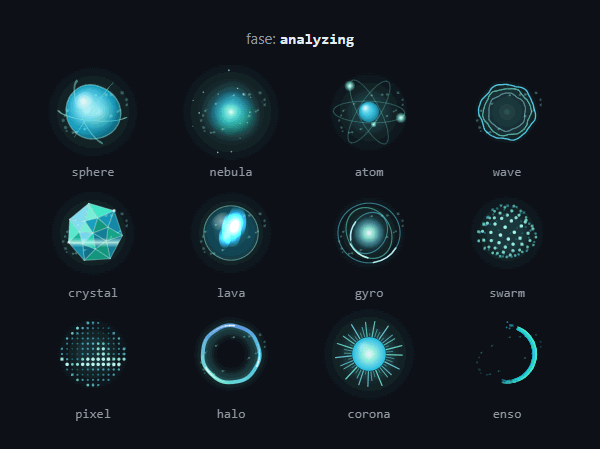

# diplez · componentes para interfaces de IA

Paquetes de **Web Components** para construir interfaces de IA: funcionan igual en React, Vue,
Angular, Svelte o HTML plano, y se adaptan a tu marca cambiando una variable de color.

<p align="center"></p>

## Paquetes

| Paquete                                                          | Versión                                                                                                                   | Qué incluye                                                                                 |
| ---------------------------------------------------------------- | ------------------------------------------------------------------------------------------------------------------------- | ------------------------------------------------------------------------------------------- |
| [`@diplez/ai-web-primitives`](packages/ai-web-primitives#readme) | [](https://www.npmjs.com/package/@diplez/ai-web-primitives) | Markdown en streaming, pasos de razonamiento, aprobaciones, citas y 12 orbes de pensamiento |

Cada paquete se instala por separado y tiene su propia documentación de uso:

```bash
npm install @diplez/ai-web-primitives
```

## Desarrollo

```bash
git clone https://github.com/diplez/ai-web-primitives.git
cd ai-web-primitives
npm install          # instala y enlaza todos los paquetes
npm run validate     # formato, lint, tipos, tests y build de cada paquete
```

La estructura del monorepo, la arquitectura, los estándares de código y cómo agregar componentes
o paquetes nuevos están en [`CONTRIBUTING.md`](CONTRIBUTING.md).

## Licencia

[MIT](LICENSE) © diplez
