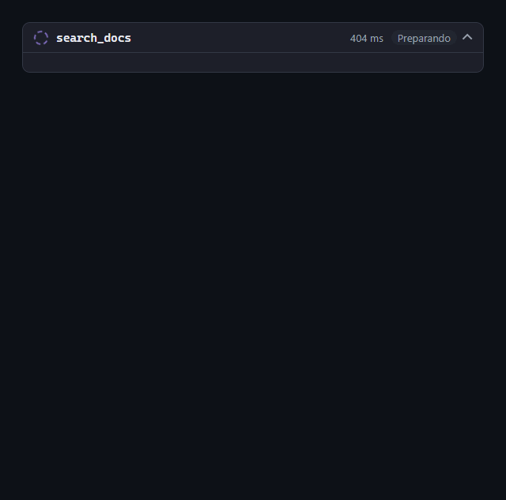

# @diplez/ai-agent-ui

Componentes para **supervisar agentes de IA** mientras trabajan: cada llamada a herramienta en
vivo y una línea de tiempo que se **rebobina** y se **bifurca**. Son **Web Components**:
funcionan igual en React, Vue, Angular, Svelte o HTML plano.

> Estado: desarrollo temprano (`0.x`). La API pública puede cambiar entre versiones menores hasta
> la `1.0.0`.

| Componente            | Para qué sirve                                                                           |
| --------------------- | ---------------------------------------------------------------------------------------- |
| `<dz-tool-call>`      | Una llamada a herramienta en vivo: argumentos en streaming, ejecución, resultado o error |
| `<dz-agent-timeline>` | La "caja negra" del agente: todo lo que hizo, para rebobinar, repetir y bifurcar         |

Combina con [`@diplez/ai-web-primitives`](https://www.npmjs.com/package/@diplez/ai-web-primitives)
(markdown en streaming, razonamiento, aprobaciones, orbes): usan las mismas variables de tema.

---

## Tabla de contenidos

- [Empezar en 1 minuto](#empezar-en-1-minuto)
- [Componentes](#componentes)
- [Colores y tema](#colores-y-tema)
- [Idiomas](#idiomas)
- [Uso con frameworks](#uso-con-frameworks)
- [Entradas del paquete](#entradas-del-paquete)
- [Compatibilidad](#compatibilidad)
- [Licencia](#licencia)

---

## Empezar en 1 minuto

```bash
npm install @diplez/ai-agent-ui
```

```js
import { defineAll } from "@diplez/ai-agent-ui";
defineAll({ locale: "es" }); // registra todos los componentes, con textos en español
```

```html
<dz-agent-timeline id="historial" forkable></dz-agent-timeline>
<dz-tool-call id="busqueda" name="search_docs"></dz-tool-call>

<script type="module">
  const herramienta = document.querySelector("#busqueda");
  herramienta.appendArgs('{"query": "paginación"}'); // los argumentos pueden llegar a pedazos
  herramienta.run();
  herramienta.complete({ total: 2 });

  document.querySelector("#historial").addEvent({ kind: "tool", title: "search_docs" });
</script>
```

Otras formas de registrar:

```js
import "@diplez/ai-agent-ui/define"; // todo, en inglés
import "@diplez/ai-agent-ui/tool-call/define"; // solo un componente (mejor tree-shaking)
import { defineToolCall } from "@diplez/ai-agent-ui";
defineToolCall({ tagName: "mi-herramienta", locale: "es" });
```

> El import raíz (`@diplez/ai-agent-ui`) **no registra nada** por sí solo: registrar es siempre
> explícito, con `defineAll()`, un `define*()` o un import `…/define`.

**Sin bundler** (HTML plano, prototipos):

```html
<script type="module">
  import { defineAll } from "https://cdn.jsdelivr.net/npm/@diplez/ai-agent-ui/+esm";
  defineAll({ locale: "es" });
</script>
```

---

## Componentes

### `<dz-tool-call>`: llamada a herramienta en vivo

<p align="center"></p>

Muestra una llamada del modelo a una herramienta (function calling) durante todo su ciclo:

| Estado (`status`) | Qué se ve                                                   |
| ----------------- | ----------------------------------------------------------- |
| `pending`         | El modelo está escribiendo los argumentos: aparecen en vivo |
| `running`         | La herramienta se ejecuta: indicador giratorio y cronómetro |
| `success`         | Terminó: duración y resultado (JSON resaltado o texto)      |
| `error`           | Falló: el mensaje de error en rojo                          |

Los argumentos aceptan **JSON incompleto**: se muestran formateados desde el primer carácter,
cerrando strings y llaves que todavía no llegaron. La cabecera resume el primer valor
(`query: "paginación"`) para entender la llamada sin abrirla.

```js
const herramienta = document.querySelector("dz-tool-call");

// OpenAI (Chat Completions con stream: true)
for await (const chunk of stream) {
  const delta = chunk.choices[0]?.delta?.tool_calls?.[0];
  if (delta?.function?.name) herramienta.name = delta.function.name;
  if (delta?.function?.arguments) herramienta.appendArgs(delta.function.arguments);
}

// Anthropic (Messages con stream: true)
for await (const event of stream) {
  if (event.type === "content_block_start" && event.content_block.type === "tool_use") {
    herramienta.name = event.content_block.name;
  }
  if (event.type === "content_block_delta" && event.delta.type === "input_json_delta") {
    herramienta.appendArgs(event.delta.partial_json);
  }
}

herramienta.run(); // empieza a ejecutarse
try {
  herramienta.complete(await ejecutar(herramienta.args)); // resultado: objeto o texto
} catch (error) {
  herramienta.fail(error.message);
}
```

| Atributo / propiedad | Valores                                      | Descripción                                        |
| -------------------- | -------------------------------------------- | -------------------------------------------------- |
| `name`               | texto                                        | Nombre de la herramienta                           |
| `status`             | `pending` · `running` · `success` · `error`  | Estado (reflejado, para estilizar)                 |
| `args`               | texto JSON (puede estar incompleto) u objeto | Argumentos                                         |
| `result`             | objeto o texto (propiedad)                   | Resultado; si el texto es JSON, se resalta         |
| `error`              | texto                                        | Mensaje de error                                   |
| `duration`           | milisegundos                                 | Duración conocida (p. ej. al mostrar el historial) |
| `open`               | booleano                                     | Panel expandido                                    |

Métodos: `appendArgs(fragmento)`, `run()`, `complete(resultado?)`, `fail(mensaje)`, `reset()`.
Evento: `dz-toggle` (`{ open }`). Sin `duration`, el cronómetro mide solo desde que la llamada
está activa hasta que termina.

¿Necesitas el JSON parcial sin el componente? `parsePartialJson(texto)` devuelve
`{ value, complete }` con lo que se pueda interpretar.

### `<dz-agent-timeline>`: la caja negra del agente

<p align="center"></p>

Una línea de tiempo con todo lo que hizo el agente. En **modo en vivo** sigue al último evento;
al arrastrar el control o hacer clic en un evento queda fijo en ese paso, con los posteriores
atenuados, como al rebobinar un video. **Repetir** reproduce la ejecución paso a paso y, con
`forkable`, cada paso ofrece **Bifurcar desde aquí** para que tu app relance el agente desde ese
punto.

```js
const historial = document.querySelector("dz-agent-timeline");

const id = historial.addEvent({ kind: "tool", title: "search_docs", status: "running" });
historial.updateEvent(id, { status: "done", detail: "2 resultados" });
historial.addEvent({ kind: "decision", title: "Usar cursor opaco", detail: "Evita exponer IDs." });

historial.addEventListener("dz-fork", (event) => {
  const { event: paso, index } = event.detail;
  relanzarAgenteDesde(index, paso); // tu lógica: volver a ese estado y probar otro camino
});
```

Cada evento es un texto o un objeto:

| Campo    | Valores                                                           | Descripción                                      |
| -------- | ----------------------------------------------------------------- | ------------------------------------------------ |
| `title`  | texto                                                             | Qué pasó                                         |
| `kind`   | `message` · `tool` · `decision` · `file` · `error` · `checkpoint` | Tipo: define el ícono y el color                 |
| `detail` | texto                                                             | Se muestra al seleccionar el evento              |
| `status` | `running` · `done` · `error`                                      | Estado (los `running` laten)                     |
| `at`     | milisegundos                                                      | Marca de tiempo; `addEvent()` usa la hora actual |
| `id`     | texto                                                             | Identificador (`addEvent()` lo genera si falta)  |

| Atributo / propiedad | Valores      | Descripción                                          |
| -------------------- | ------------ | ---------------------------------------------------- |
| `events`             | array (JSON) | Todos los eventos de una vez, p. ej. desde tu estado |
| `forkable`           | booleano     | Muestra "Bifurcar desde aquí" y emite `dz-fork`      |
| `replay-interval`    | milisegundos | Tiempo entre eventos al repetir (por defecto 700)    |

Métodos: `addEvent(evento)`, `updateEvent(id, cambios)`, `select(índice)`, `goLive()`,
`replay()`, `pause()`, `clear()`. Propiedad de solo lectura: `live`. Eventos: `dz-select`
(`{ event, index, live }`) y `dz-fork` (`{ event, index }`).

El control se maneja con teclado (flechas, Inicio, Fin) y anuncia el paso a lectores de pantalla.
El alto máximo de la lista se ajusta con `--dz-timeline-max-height` (320px por defecto).

---

## Colores y tema

Los componentes usan las mismas variables `--dz-*` que `@diplez/ai-web-primitives`, así que un
solo tema sirve para los dos paquetes:

```css
:root {
  --dz-accent: #0ea5e9; /* color de marca */
  --dz-radius: 14px;
}
```

| Variable                                      | Para qué                                              |
| --------------------------------------------- | ----------------------------------------------------- |
| `--dz-accent`                                 | Color principal: estado en curso, cursor, claves JSON |
| `--dz-text`, `--dz-muted`                     | Texto principal y secundario                          |
| `--dz-surface`, `--dz-surface-raised`         | Fondos                                                |
| `--dz-border`                                 | Bordes                                                |
| `--dz-success`, `--dz-warning`, `--dz-danger` | Estados (y colores del JSON resaltado)                |
| `--dz-radius`, `--dz-font`, `--dz-font-mono`  | Forma y tipografía                                    |
| `--dz-code-bg`                                | Fondo de los bloques de argumentos y resultado        |

Los valores por defecto siguen el `color-scheme` de la página (claro u oscuro). Para cambios más
finos están las partes CSS (`::part(header)`, `::part(event)`, `::part(fork-button)`…), listadas
en `custom-elements.json`.

---

## Idiomas

Inglés (`en`, por defecto) y español (`es`) incluidos:

```js
defineAll({ locale: "es" });
defineAgentTimeline({ locale: "es", messages: { fork: "Probar otro camino" } });
```

Para otro idioma, pasar todos los textos en `messages` (ver `ENGLISH_UI_MESSAGES`).

---

## Uso con frameworks

| Entorno           | Cómo usarlo                                                                                                                   |
| ----------------- | ----------------------------------------------------------------------------------------------------------------------------- |
| **React 19+**     | `defineAll()` una vez y usar las etiquetas. Tipos: `import type {} from "@diplez/ai-agent-ui/react"`                          |
| **Next.js / SSR** | Llamar `defineAll()` dentro de un componente `"use client"` (se registran en el navegador)                                    |
| **Vue 3**         | `isCustomElement: (tag) => tag.startsWith("dz-")` en el plugin de Vue. Tipos: `import type {} from "@diplez/ai-agent-ui/vue"` |
| **Angular**       | Agregar `CUSTOM_ELEMENTS_SCHEMA` al componente                                                                                |
| **Svelte / HTML** | Funciona directo                                                                                                              |

**React**: las propiedades (`events`, `status`, `args`…) se pasan como props y quedan tipadas.
Los eventos se escuchan con una `ref`:

```tsx
import type {} from "@diplez/ai-agent-ui/react";

function Historial({ eventos, onFork }) {
  const ref = useRef<HTMLElement>(null);
  useEffect(() => {
    const el = ref.current!;
    const handler = (e: Event) => onFork((e as CustomEvent).detail.index);
    el.addEventListener("dz-fork", handler);
    return () => el.removeEventListener("dz-fork", handler);
  }, [onFork]);
  return <dz-agent-timeline ref={ref} events={eventos} forkable />;
}
```

---

## Entradas del paquete

| Import                                     | Efecto secundario | Contenido                                                       |
| ------------------------------------------ | ----------------- | --------------------------------------------------------------- |
| `@diplez/ai-agent-ui`                      | No                | Clases, `defineAll()`, `define*()`, `parsePartialJson()`, tipos |
| `@diplez/ai-agent-ui/define`               | Sí                | Registra todos los componentes                                  |
| `@diplez/ai-agent-ui/<componente>/define`  | Sí                | Registra un componente (`tool-call`, `agent-timeline`)          |
| `@diplez/ai-agent-ui/react`, `/vue`        | No (solo tipos)   | Tipos de las etiquetas para JSX y plantillas de Vue             |
| `@diplez/ai-agent-ui/custom-elements.json` | —                 | Manifiesto de custom elements                                   |

El paquete es **solo ESM**. Los consumidores CommonJS deben usar `import()` dinámico.

---

## Compatibilidad

- Navegadores modernos (2024 en adelante): Chrome/Edge 123+, Firefox 120+, Safari 17.5+ (usa
  `light-dark()` y `color-mix()` para el tema).
- Respeta `prefers-reduced-motion`: sin animaciones de pulso ni giro.
- Sin dependencias de framework; la única dependencia de runtime es `lit`.

Sigue **[SemVer](https://semver.org/lang/es/)**. Mientras esté en `0.x`, los cambios que rompen
compatibilidad suben la versión menor. La arquitectura y cómo contribuir están en
[`CONTRIBUTING.md`](https://github.com/diplez/ai-web-primitives/blob/main/CONTRIBUTING.md).

---

## Licencia

[MIT](LICENSE) © diplez
