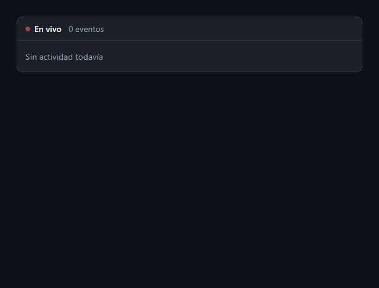

# @diplez/ai-agent-ui

**Muestra a tus usuarios qué está haciendo tu agente de IA.** Dos componentes listos para usar:

- **`<dz-tool-call>`**: cada vez que el agente usa una herramienta (buscar, leer un archivo,
  correr tests…), muestra qué le pidió, si sigue trabajando y qué obtuvo.
- **`<dz-agent-timeline>`**: el historial de todo lo que hizo el agente. Se puede volver a
  cualquier paso, reproducirlo como un video y reintentar desde ahí.

Funcionan en **React, Vue, Angular, Svelte o HTML plano** (son Web Components).

<p align="center"></p>

> Versión temprana (`0.x`): la API puede cambiar antes de la `1.0.0`.

---

## Contenido

- [Instalar y usar](#instalar-y-usar)
- [`<dz-tool-call>`: una herramienta en uso](#dz-tool-call-una-herramienta-en-uso)
- [`<dz-agent-timeline>`: el historial del agente](#dz-agent-timeline-el-historial-del-agente)
- [Cambiar colores](#cambiar-colores)
- [Idioma de los textos](#idioma-de-los-textos)
- [Usar con React, Vue o Angular](#usar-con-react-vue-o-angular)
- [Requisitos](#requisitos)
- [Detalles técnicos](#detalles-técnicos)

---

## Instalar y usar

**1. Instalar**

```bash
npm install @diplez/ai-agent-ui
```

**2. Registrar los componentes** (una sola vez, al iniciar tu app)

```js
import "@diplez/ai-agent-ui/define";
```

**3. Usarlos como cualquier etiqueta HTML**

```html
<dz-tool-call name="search_docs" status="running" args='{"query": "pagination"}'></dz-tool-call>

<dz-agent-timeline events='["Read the request", "Searched the docs", "Wrote the answer"]'>
</dz-agent-timeline>
```

¿Sin bundler? Cárgalo directo desde un CDN:

```html
<script type="module">
  import { defineAll } from "https://cdn.jsdelivr.net/npm/@diplez/ai-agent-ui/+esm";
  defineAll();
</script>
```

---

## `<dz-tool-call>`: una herramienta en uso

<p align="center"></p>

Una tarjeta que acompaña a la herramienta de principio a fin:

| Estado    | Qué ve el usuario                                                |
| --------- | ---------------------------------------------------------------- |
| `pending` | El agente está escribiendo lo que le va a pedir a la herramienta |
| `running` | La herramienta está trabajando, con un cronómetro                |
| `success` | Terminó: cuánto tardó y qué devolvió                             |
| `error`   | Falló: el mensaje de error, en rojo                              |

La cabecera resume la llamada en una línea (`query: "pagination"`); al hacer clic se abre el
detalle con la **entrada** (lo que se pidió) y la **salida** (lo que devolvió).

### Ejemplo básico

```js
const tool = document.querySelector("dz-tool-call");

tool.name = "search_docs";
tool.args = { query: "pagination" }; // lo que se le pide a la herramienta
tool.run(); // empieza a trabajar → "Running" + cronómetro

tool.complete({ total: 2 }); // terminó bien → muestra la salida
// o, si algo salió mal:
tool.fail("Timeout after 30 s");
```

### Mientras el modelo escribe

Los modelos envían la entrada de la herramienta **en pedazos**. Pásaselos tal cual llegan con
`appendArgs()`: el componente los muestra ordenados desde el primer carácter, aunque todavía
estén incompletos.

<details>
<summary>Ejemplo con OpenAI y con Anthropic</summary>

```js
// OpenAI (Chat Completions con stream: true)
for await (const chunk of stream) {
  const call = chunk.choices[0]?.delta?.tool_calls?.[0];
  if (call?.function?.name) tool.name = call.function.name;
  if (call?.function?.arguments) tool.appendArgs(call.function.arguments);
}

// Anthropic (Messages con stream: true)
for await (const event of stream) {
  if (event.type === "content_block_start" && event.content_block.type === "tool_use") {
    tool.name = event.content_block.name;
  }
  if (event.type === "content_block_delta" && event.delta.type === "input_json_delta") {
    tool.appendArgs(event.delta.partial_json);
  }
}
```

</details>

### Opciones

| Atributo   | Para qué                                                         |
| ---------- | ---------------------------------------------------------------- |
| `name`     | Nombre de la herramienta                                         |
| `status`   | `pending`, `running`, `success` o `error`                        |
| `args`     | Entrada: un objeto o un texto JSON (puede estar incompleto)      |
| `result`   | Salida: un objeto o un texto (solo como propiedad de JavaScript) |
| `error`    | Mensaje de error                                                 |
| `duration` | Cuánto tardó, en milisegundos (útil al mostrar llamadas pasadas) |
| `open`     | Mostrar el detalle abierto                                       |

| Método              | Qué hace                         |
| ------------------- | -------------------------------- |
| `appendArgs(texto)` | Suma un pedazo de la entrada     |
| `run()`             | Pasa a "trabajando"              |
| `complete(salida?)` | Termina bien y muestra la salida |
| `fail(mensaje)`     | Termina con error                |
| `reset()`           | Vuelve a empezar                 |

---

## `<dz-agent-timeline>`: el historial del agente

Una lista con cada cosa que hizo el agente, en orden y con su tiempo (`+0:15`). Permite:

- **Ver en vivo**: cada evento nuevo aparece al final.
- **Volver a un paso**: arrastrando la barra o haciendo clic en un evento. Los pasos posteriores
  se atenúan, como al retroceder un video.
- **Reproducir**: recorre la ejecución paso a paso.
- **Reintentar desde aquí** (opcional): avisa a tu app desde qué paso quiere el usuario volver a
  intentar.

### Ejemplo básico

```js
const timeline = document.querySelector("dz-agent-timeline");

timeline.addEvent({ kind: "message", title: "Request: add pagination to /orders" });
timeline.addEvent({ kind: "tool", title: "search_docs", detail: "2 results" });
timeline.addEvent({ kind: "decision", title: "Use an opaque cursor" });
```

Cada evento tiene un **título** y, si quieres:

| Campo    | Para qué                                                                                               |
| -------- | ------------------------------------------------------------------------------------------------------ |
| `kind`   | El tipo, que define el ícono y el color: `message`, `tool`, `decision`, `file`, `error` o `checkpoint` |
| `detail` | Texto extra que se ve al seleccionar el evento                                                         |
| `status` | `running` (late mientras dura), `done` o `error`                                                       |
| `at`     | Hora del evento en milisegundos (si no la pasas, se usa la actual)                                     |

Para cambiar un evento que ya está en la lista (por ejemplo, cuando una herramienta termina):

```js
const id = timeline.addEvent({ kind: "tool", title: "run_tests", status: "running" });
// …más tarde
timeline.updateEvent(id, { status: "done", detail: "14 tests passed" });
```

### Reintentar desde un paso

Agrega el atributo `forkable` y escucha el evento `dz-fork`. El componente **solo avisa** qué paso
eligió el usuario; volver a ejecutar el agente desde ahí lo decide tu app.

```html
<dz-agent-timeline forkable></dz-agent-timeline>
```

```js
timeline.addEventListener("dz-fork", (event) => {
  const { index, event: step } = event.detail;
  restartAgentFrom(index); // tu lógica
});
```

### Opciones

| Atributo          | Para qué                                                 |
| ----------------- | -------------------------------------------------------- |
| `events`          | Todos los eventos de una vez (un array)                  |
| `forkable`        | Muestra "Retry from here" en el paso elegido             |
| `replay-interval` | Milisegundos entre pasos al reproducir (700 por defecto) |

| Método                 | Qué hace                          |
| ---------------------- | --------------------------------- |
| `addEvent(evento)`     | Agrega un evento y devuelve su id |
| `updateEvent(id, …)`   | Cambia un evento existente        |
| `select(índice)`       | Va a un paso                      |
| `goLive()`             | Vuelve a seguir el último evento  |
| `replay()` / `pause()` | Reproduce / pausa                 |
| `clear()`              | Vacía el historial                |

Eventos que emite: `dz-select` (el usuario eligió un paso) y `dz-fork` (pidió reintentar).

---

## Cambiar colores

Con variables CSS, en tu hoja de estilos:

```css
:root {
  --dz-accent: #0ea5e9; /* tu color de marca */
  --dz-radius: 14px; /* bordes más redondeados */
}
```

Se adaptan solos al modo claro u oscuro de tu página. Son las mismas variables de
[`@diplez/ai-web-primitives`](https://www.npmjs.com/package/@diplez/ai-web-primitives): un solo
tema sirve para los dos paquetes.

<details>
<summary>Todas las variables</summary>

| Variable                                      | Para qué                          |
| --------------------------------------------- | --------------------------------- |
| `--dz-accent`                                 | Color principal                   |
| `--dz-text`, `--dz-muted`                     | Texto principal y secundario      |
| `--dz-surface`, `--dz-surface-raised`         | Fondos                            |
| `--dz-border`                                 | Bordes                            |
| `--dz-success`, `--dz-warning`, `--dz-danger` | Colores de estado                 |
| `--dz-radius`, `--dz-font`, `--dz-font-mono`  | Forma y tipografía                |
| `--dz-code-bg`                                | Fondo de la entrada y la salida   |
| `--dz-timeline-max-height`                    | Alto máximo del historial (320px) |

</details>

---

## Idioma de los textos

Los textos vienen en inglés. Para español, registra los componentes así:

```js
import { defineAll } from "@diplez/ai-agent-ui";
defineAll({ locale: "es" });
```

También puedes cambiar textos sueltos:

```js
import { defineAgentTimeline } from "@diplez/ai-agent-ui";
defineAgentTimeline({ messages: { fork: "Try another way" } });
```

---

## Usar con React, Vue o Angular

| Framework         | Qué hacer                                                                                                          |
| ----------------- | ------------------------------------------------------------------------------------------------------------------ |
| **React 19+**     | Importa `@diplez/ai-agent-ui/define` y usa las etiquetas. Tipos: `import type {} from "@diplez/ai-agent-ui/react"` |
| **Next.js**       | Igual, pero dentro de un componente `"use client"`                                                                 |
| **Vue 3**         | En el plugin de Vue: `isCustomElement: (tag) => tag.startsWith("dz-")`. Tipos: `@diplez/ai-agent-ui/vue`           |
| **Angular**       | Agrega `CUSTOM_ELEMENTS_SCHEMA` al componente                                                                      |
| **Svelte / HTML** | Funciona directo                                                                                                   |

<details>
<summary>Ejemplo en React</summary>

```tsx
import "@diplez/ai-agent-ui/define";
import type {} from "@diplez/ai-agent-ui/react";

function History({ events, onRetry }) {
  const ref = useRef<HTMLElement>(null);
  useEffect(() => {
    const el = ref.current!;
    const handler = (e: Event) => onRetry((e as CustomEvent).detail.index);
    el.addEventListener("dz-fork", handler);
    return () => el.removeEventListener("dz-fork", handler);
  }, [onRetry]);
  return <dz-agent-timeline ref={ref} events={events} forkable />;
}
```

</details>

---

## Requisitos

- Navegadores de 2024 en adelante: Chrome/Edge 123+, Firefox 120+, Safari 17.5+.
- Sin dependencias de framework (solo `lit`).
- Respeta la preferencia "reducir movimiento" del sistema.

---

## Detalles técnicos

<details>
<summary>Formas de importar</summary>

| Import                                      | Qué hace                                                     |
| ------------------------------------------- | ------------------------------------------------------------ |
| `@diplez/ai-agent-ui/define`                | Registra todos los componentes                               |
| `@diplez/ai-agent-ui/tool-call/define`      | Registra solo `<dz-tool-call>`                               |
| `@diplez/ai-agent-ui/agent-timeline/define` | Registra solo `<dz-agent-timeline>`                          |
| `@diplez/ai-agent-ui`                       | No registra nada: clases, `defineAll()`, `define*()` y tipos |
| `@diplez/ai-agent-ui/react`, `/vue`         | Solo tipos para JSX y plantillas de Vue                      |

El paquete es solo ESM. Para personalizar a fondo hay partes CSS (`::part(header)`,
`::part(event)`, `::part(fork-button)`…), listadas en `custom-elements.json`.

`parsePartialJson(texto)` interpreta JSON incompleto sin usar el componente.

</details>

Sigue [SemVer](https://semver.org/lang/es/). Arquitectura y cómo contribuir:
[`CONTRIBUTING.md`](https://github.com/diplez/ai-web-primitives/blob/main/CONTRIBUTING.md).

## Licencia

[MIT](LICENSE) © diplez
