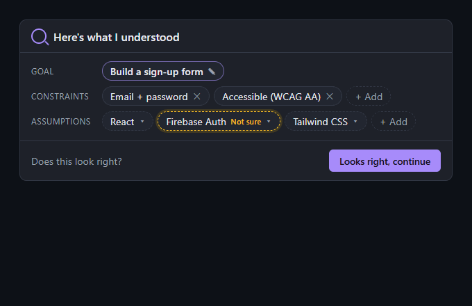
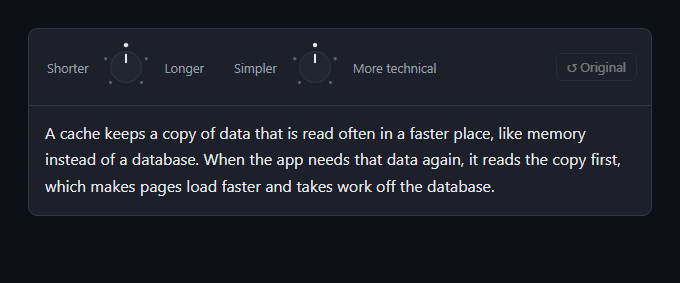

# @diplez/ai-steer-ui

**Deja que tus usuarios dirijan a la IA sin escribir otro prompt.** Dos componentes listos para
usar:

- **`<dz-intent-lens>`**: antes de actuar, el agente muestra **lo que entendió** (objetivo,
  restricciones y suposiciones) en fichas. El usuario corrige lo que esté mal con un clic y el
  agente sigue con eso.
- **`<dz-answer-dial>`**: después de responder, el usuario **ajusta la respuesta girando una
  perilla** (más corta, más simple, más formal) y el texto cambia en su lugar, palabra por
  palabra.

Funcionan en **React, Vue, Angular, Svelte o HTML plano** (son Web Components).

<p align="center"></p>

> Versión temprana (`0.x`): la API puede cambiar antes de la `1.0.0`.

---

## Contenido

- [Instalar y usar](#instalar-y-usar)
- [`<dz-intent-lens>`: lo que entendió el agente](#dz-intent-lens-lo-que-entendió-el-agente)
- [`<dz-answer-dial>`: perillas para la respuesta](#dz-answer-dial-perillas-para-la-respuesta)
- [Cambiar colores](#cambiar-colores)
- [Idioma de los textos](#idioma-de-los-textos)
- [Usar con React, Vue o Angular](#usar-con-react-vue-o-angular)
- [Requisitos](#requisitos)
- [Detalles técnicos](#detalles-técnicos)

---

## Instalar y usar

**1. Instalar**

```bash
npm install @diplez/ai-steer-ui
```

**2. Registrar los componentes** (una sola vez, al iniciar tu app)

```js
import "@diplez/ai-steer-ui/define";
```

**3. Usarlos**: cada componente tiene su ejemplo abajo.

---

## `<dz-intent-lens>`: lo que entendió el agente

Antes de que el agente trabaje varios minutos, la lente muestra cómo interpretó el pedido:

| Ficha             | Qué puede hacer el usuario                           |
| ----------------- | ---------------------------------------------------- |
| **Objetivo**      | Editarlo                                             |
| **Restricciones** | Quitarlas (✕) o agregar las suyas (+ Add)            |
| **Suposiciones**  | Elegir otra alternativa, escribir la suya o quitarla |

Las suposiciones en las que el modelo **no estaba seguro** se marcan con _Not sure_ para que el
usuario las mire primero. Al confirmar, tu app recibe las correcciones y una instrucción lista
para devolverle al modelo.

### Ejemplo básico

```html
<dz-intent-lens id="lens"></dz-intent-lens>
```

```js
import { INTENT_REQUEST_PROMPT, parseIntentResponse } from "@diplez/ai-steer-ui";

const lens = document.querySelector("#lens");

// 1. Pídele al modelo su interpretación (INTENT_REQUEST_PROMPT le explica el formato).
const reply = await askMyModel(userRequest, INTENT_REQUEST_PROMPT);
lens.intent = parseIntentResponse(reply);

// 2. Cuando el usuario confirma, devuélvele al modelo las correcciones y sigue con la tarea.
lens.addEventListener("dz-intent-confirm", async (event) => {
  const { instruction } = event.detail;
  // "The user reviewed your interpretation… - Use "Vue" instead of "React". …"
  await continueAgent(instruction);
});
```

También puedes armar la interpretación tú mismo:

```js
lens.intent = {
  goal: "Build a sign-up form",
  constraints: ["Email + password", "Accessible"],
  assumptions: [
    { text: "React", options: ["Vue", "Plain HTML"], confidence: 0.85 },
    { text: "Firebase Auth", options: ["Supabase"], confidence: 0.35 }, // se marca como dudosa
  ],
};
```

| Campo de una suposición | Para qué                                                          |
| ----------------------- | ----------------------------------------------------------------- |
| `text`                  | La suposición                                                     |
| `options`               | Alternativas que el usuario puede elegir                          |
| `confidence`            | Qué tan seguro estaba el modelo, de 0 a 1 (menos de 0.6 = dudosa) |

### Opciones

| Atributo / propiedad | Para qué                                                                     |
| -------------------- | ---------------------------------------------------------------------------- |
| `intent`             | La interpretación del modelo. Si cambia, se empieza de nuevo                 |
| `heading`            | Título (por defecto, "Here's what I understood")                             |
| `status`             | `review` mientras se revisa, `confirmed` después (reflejado, para estilizar) |
| `result`             | Solo lectura: interpretación final, correcciones e instrucción               |

| Método         | Qué hace                                              |
| -------------- | ----------------------------------------------------- |
| `confirm()`    | Confirma (igual que el botón) y devuelve el resultado |
| `reset()`      | Deshace las correcciones del usuario                  |
| `reopen()`     | Vuelve a permitir correcciones después de confirmar   |
| `edit(cambio)` | Aplica una corrección desde código                    |

Eventos: `dz-intent-change` (el usuario corrigió algo) y `dz-intent-confirm` (confirmó). Los
dos traen `{ intent, changes, instruction }`.

Todo se maneja también con el teclado: las fichas son botones, Enter confirma lo que escribes y
Escape cancela o cierra el menú.

---

## `<dz-answer-dial>`: perillas para la respuesta

<p align="center"></p>

¿Muy larga? Gira hacia _Shorter_. ¿Muy técnica? Gira hacia _Simpler_. La respuesta se reescribe
y cambia **en su lugar, palabra por palabra**, así se ve exactamente qué cambió.

### Ejemplo básico

```html
<dz-answer-dial id="answer"></dz-answer-dial>
```

```js
const answer = document.querySelector("#answer");

answer.text = "A cache keeps a copy of data that is read often…"; // la respuesta del modelo
answer.rewrite = async ({ instruction, original }) => {
  // instruction ya viene armada para el modelo, por ejemplo:
  // "Rewrite your previous answer. - Make it much shorter. Keep the same facts…"
  return await askMyModel(original, instruction); // tu función: devuelve el texto nuevo
};
```

Eso es todo. El componente se encarga del resto:

- **Espera a que el usuario deje de girar** antes de llamar a tu modelo (no lo llama en cada
  paso).
- **Recuerda cada posición**: si el usuario vuelve a una que ya vio, la muestra al instante sin
  volver a llamar al modelo.
- **Si el usuario sigue girando** mientras el modelo responde, cancela la llamada vieja (con
  `signal`) y solo muestra la última.
- **La posición central es la respuesta original**, y el botón _Original_ vuelve a ella.

### Conectarlo a tu modelo

La función `rewrite` recibe:

| Campo         | Qué es                                                                      |
| ------------- | --------------------------------------------------------------------------- |
| `instruction` | La instrucción lista para enviar al modelo (en inglés, que entienden mejor) |
| `original`    | La respuesta original, sin reescrituras                                     |
| `values`      | La posición de cada perilla, por ejemplo `{ length: 0, level: 3 }`          |
| `signal`      | Se cancela si el usuario vuelve a girar; pásalo a tu `fetch`                |

<details>
<summary>Ejemplo con OpenAI</summary>

```js
answer.rewrite = async ({ instruction, original, signal }) => {
  const response = await fetch("/api/rewrite", {
    method: "POST",
    headers: { "Content-Type": "application/json" },
    body: JSON.stringify({ original, instruction }),
    signal,
  });
  return (await response.json()).text;
};

// En tu servidor (/api/rewrite):
const completion = await openai.chat.completions.create({
  model: "gpt-4o-mini",
  messages: [
    { role: "assistant", content: original },
    { role: "user", content: instruction },
  ],
});
return { text: completion.choices[0].message.content };
```

</details>

<details>
<summary>Sin la función <code>rewrite</code> (escuchando un evento)</summary>

Si prefieres manejar tú las llamadas, no asignes `rewrite`: escucha `dz-dial-change` y entrega
el texto con `showRewrite()`.

```js
answer.addEventListener("dz-dial-change", async (event) => {
  const { instruction, cached } = event.detail;
  if (cached) return; // esa posición ya se conocía: el componente ya la mostró
  answer.showRewrite(await askMyModel(answer.text, instruction));
});
```

</details>

### Elegir las perillas

Por defecto aparecen dos: **Shorter ↔ Longer** y **Simpler ↔ More technical**. Hay una tercera
incluida, **Casual ↔ Formal**:

```html
<dz-answer-dial dials='["length", "tone"]'></dz-answer-dial>
```

También puedes crear las tuyas:

```js
answer.dials = [
  "length",
  { id: "humor", start: "Serious", end: "Funny" },
  { id: "audience", start: "For kids", end: "For experts", steps: 7 },
];
```

| Campo                  | Para qué                                                            |
| ---------------------- | ------------------------------------------------------------------- |
| `id`                   | Nombre de la perilla (aparece en `values`)                          |
| `start`, `end`         | Etiquetas de cada extremo                                           |
| `startHint`, `endHint` | Cómo pedírselo al modelo (por defecto, las etiquetas en minúsculas) |
| `steps`                | Cantidad de posiciones: 3, 5 (por defecto), 7 o 9                   |

### Opciones

| Atributo / propiedad | Para qué                                                                  |
| -------------------- | ------------------------------------------------------------------------- |
| `text`               | La respuesta original. Si cambia, las perillas vuelven al centro          |
| `rewrite`            | La función que reescribe la respuesta (solo como propiedad de JavaScript) |
| `dials`              | Qué perillas mostrar                                                      |
| `values`             | Posición de cada perilla (también se puede asignar)                       |
| `settle-delay`       | Milisegundos que espera a que el usuario deje de girar (350)              |
| `busy`               | Solo lectura: `true` mientras se reescribe                                |

| Método                  | Qué hace                                      |
| ----------------------- | --------------------------------------------- |
| `setDial(id, posición)` | Mueve una perilla                             |
| `reset()`               | Vuelve a la respuesta original                |
| `showRewrite(texto)`    | Entrega la reescritura (si no usas `rewrite`) |

Eventos: `dz-dial-change` (las perillas se detuvieron en una posición nueva) y
`dz-rewrite-error` (la función `rewrite` falló; el componente muestra un aviso).

Las perillas se usan con el mouse (arrastrando en círculo, con la rueda o haciendo clic en las
etiquetas) y con el teclado (flechas, Inicio, Fin y Escape para volver al centro). Los lectores
de pantalla anuncian la posición: "Shorter, 1 of 2".

---

## Cambiar colores

```css
:root {
  --dz-accent: #0ea5e9; /* perillas, palabras que cambian, objetivo y correcciones */
  --dz-warning: #f59e0b; /* suposiciones dudosas */
}
```

Se adapta solo al modo claro u oscuro de tu página. Usa las mismas variables `--dz-*` que
[`@diplez/ai-web-primitives`](https://www.npmjs.com/package/@diplez/ai-web-primitives) y
[`@diplez/ai-agent-ui`](https://www.npmjs.com/package/@diplez/ai-agent-ui): un solo tema sirve
para todos.

---

## Idioma de los textos

Los textos vienen en inglés. Para español:

```js
import { defineAll } from "@diplez/ai-steer-ui";
defineAll({ locale: "es" });
```

La instrucción para el modelo siempre va en inglés, porque la entienden mejor. Los modelos suelen
responder en el idioma de la respuesta original; si quieres asegurarlo, agrégalo en tu prompt.

---

## Usar con React, Vue o Angular

| Framework         | Qué hacer                                                                                                        |
| ----------------- | ---------------------------------------------------------------------------------------------------------------- |
| **React 19+**     | Importa `@diplez/ai-steer-ui/define` y usa la etiqueta. Tipos: `import type {} from "@diplez/ai-steer-ui/react"` |
| **Next.js**       | Igual, pero dentro de un componente `"use client"`                                                               |
| **Vue 3**         | En el plugin de Vue: `isCustomElement: (tag) => tag.startsWith("dz-")`. Tipos: `@diplez/ai-steer-ui/vue`         |
| **Angular**       | Agrega `CUSTOM_ELEMENTS_SCHEMA` al componente                                                                    |
| **Svelte / HTML** | Funciona directo                                                                                                 |

<details>
<summary>Ejemplo en React</summary>

```tsx
import "@diplez/ai-steer-ui/define";
import type {} from "@diplez/ai-steer-ui/react";

function Answer({ text }: { text: string }) {
  const ref = useRef<HTMLElement & { rewrite?: unknown }>(null);
  useEffect(() => {
    ref.current!.rewrite = ({ instruction, original, signal }) =>
      askMyModel(original, instruction, signal);
  }, []);
  return <dz-answer-dial ref={ref} text={text} />;
}
```

</details>

---

## Requisitos

- Navegadores de 2024 en adelante: Chrome/Edge 123+, Firefox 120+, Safari 17.5+.
- Sin dependencias de framework (solo `lit`).
- Respeta la preferencia "reducir movimiento" del sistema: el texto cambia sin animación.

---

## Detalles técnicos

<details>
<summary>Formas de importar y utilidades</summary>

| Import                                   | Qué hace                                                     |
| ---------------------------------------- | ------------------------------------------------------------ |
| `@diplez/ai-steer-ui/define`             | Registra todos los componentes                               |
| `@diplez/ai-steer-ui/answer-dial/define` | Registra solo `<dz-answer-dial>`                             |
| `@diplez/ai-steer-ui/intent-lens/define` | Registra solo `<dz-intent-lens>`                             |
| `@diplez/ai-steer-ui`                    | No registra nada: clases, `defineAll()`, `define*()` y tipos |
| `@diplez/ai-steer-ui/react`, `/vue`      | Solo tipos para JSX y plantillas de Vue                      |

Sin usar el componente:

- `buildRewriteInstruction(dials, values)`: arma la instrucción para el modelo.
- `diffWords(antes, después)`: compara dos textos palabra por palabra.
- `INTENT_REQUEST_PROMPT`, `parseIntentResponse(texto)` y `buildIntentInstruction(intent)`: piden
  y procesan la interpretación del modelo.

El paquete es solo ESM. Para personalizar a fondo hay partes CSS (`::part(knob)`,
`::part(answer)`, `::part(chip)`, `::part(confirm-button)`…), listadas en `custom-elements.json`.

</details>

Sigue [SemVer](https://semver.org/lang/es/). Arquitectura y cómo contribuir:
[`CONTRIBUTING.md`](https://github.com/diplez/ai-web-primitives/blob/main/CONTRIBUTING.md).

## Licencia

[MIT](LICENSE) © diplez
