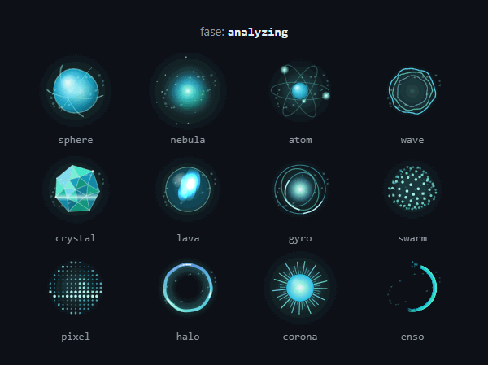
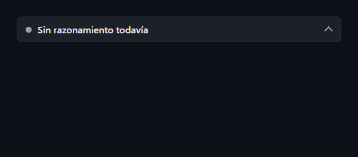
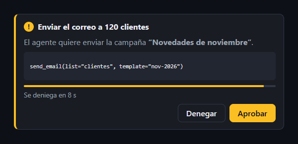
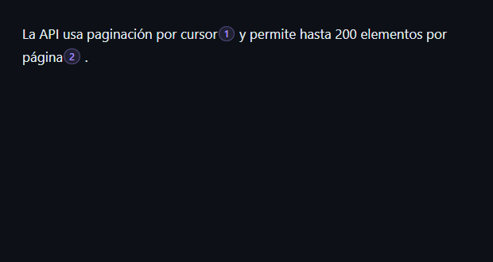

# @diplez/ai-web-primitives

Componentes de interfaz para aplicaciones de IA, como **Web Components**: funcionan igual en
React, Vue, Angular, Svelte o HTML plano. Muestran lo que hace el modelo (piensa, razona, pide
permiso, responde y cita) con una sola línea de código y se adaptan a tu marca cambiando una
variable de color.

<p align="center"></p>

> Estado: desarrollo temprano (`0.x`). La API pública puede cambiar entre versiones menores hasta
> la `1.0.0`. Roadmap: [`docs/ideas-libreria-componentes-ia.md`](https://github.com/diplez/ai-web-primitives/blob/main/docs/ideas-libreria-componentes-ia.md).

| Componente                | Para qué sirve                                                                  |
| ------------------------- | ------------------------------------------------------------------------------- |
| `<dz-markdown>`           | Respuesta del modelo en markdown, **en streaming**, segura y conectada a tu API |
| `<dz-reasoning>`          | Pasos del agente en vivo: "Pensando… 2 de 5 pasos" → "Pensó durante 12 s"       |
| `<dz-approval>`           | El agente pide permiso antes de una acción, con cuenta regresiva opcional       |
| `<dz-citation>`           | Cita de una fuente (RAG) con fragmento y nivel de coincidencia                  |
| `<dz-thinking-orb>`       | Orbe animado que expresa la fase del modelo con movimiento                      |
| `<dz-thinking-indicator>` | Indicador de estado en texto, sin estilos propios                               |

---

## Tabla de contenidos

- [Empezar en 1 minuto](#empezar-en-1-minuto)
- [Componentes](#componentes)
- [Colores y tema](#colores-y-tema)
- [Conectar con tu modelo (streaming)](#conectar-con-tu-modelo-streaming)
- [Idiomas](#idiomas)
- [Uso con frameworks](#uso-con-frameworks)
- [Entradas del paquete](#entradas-del-paquete)
- [Compatibilidad](#compatibilidad)
- [Versionado](#versionado)
- [Contribuir](#contribuir)

---

## Empezar en 1 minuto

```bash
npm install @diplez/ai-web-primitives
```

```js
import { defineAll } from "@diplez/ai-web-primitives";
defineAll({ locale: "es" }); // registra todos los componentes, con textos en español
```

```html
<dz-reasoning id="pasos"></dz-reasoning>
<dz-markdown id="respuesta"></dz-markdown>

<script type="module">
  const respuesta = document.querySelector("#respuesta");
  // Funciona con la respuesta de OpenAI, Anthropic, Vercel AI SDK o texto plano.
  await respuesta.stream(await fetch("/api/chat", { method: "POST", body: "…" }));
</script>
```

Otras formas de registrar:

```js
import "@diplez/ai-web-primitives/define"; // todo, en inglés
import "@diplez/ai-web-primitives/markdown/define"; // solo un componente (mejor tree-shaking)
import { defineMarkdown } from "@diplez/ai-web-primitives";
defineMarkdown({ tagName: "mi-markdown", locale: "es", messages: { copy: "Copiar código" } });
```

> El import raíz (`@diplez/ai-web-primitives`) **no registra nada** por sí solo: registrar es
> siempre explícito, con `defineAll()`, un `define*()` o un import `…/define`.

**Sin bundler** (HTML plano, prototipos):

```html
<script type="module">
  import { defineAll } from "https://cdn.jsdelivr.net/npm/@diplez/ai-web-primitives/+esm";
  defineAll({ locale: "es" });
</script>
```

---

## Componentes

### `<dz-markdown>`: respuestas en streaming

<p align="center"></p>

```html
<dz-markdown> # Puedes escribir el markdown **dentro** de la etiqueta </dz-markdown>
```

```js
const md = document.querySelector("dz-markdown");

md.content = "# Hola"; // reemplazar
md.appendText(" mundo"); // agregar (si manejas el stream tú)
const { text, aborted } = await md.stream(response, { signal: controller.signal });
```

- **Seguro por construcción**: el markdown se convierte en un árbol y se pinta con plantillas;
  nunca se usa `innerHTML`. Se descartan enlaces `javascript:`/`data:` y las imágenes se muestran
  como enlaces (no se cargan recursos de terceros). Apto para texto no confiable.
- **Tolerante al streaming**: `**negrita`, `` `código `` y enlaces a medio llegar se ven bien;
  las tablas aparecen recién cuando su estructura es inequívoca; cursor parpadeante mientras escribe.
- **Rendimiento**: aunque lleguen cientos de deltas por segundo, renderiza como mucho una vez por frame.
- Soporta CommonMark + tablas, tachado, listas de tareas y URLs sueltas (GFM). Bloques de código
  con lenguaje y botón **Copiar**.

| Propiedad / atributo | Tipo      | Descripción                                          |
| -------------------- | --------- | ---------------------------------------------------- |
| `content`            | `string`  | Texto markdown                                       |
| `streaming`          | `boolean` | Activa la tolerancia a contenido cortado y el cursor |

| Método                     | Descripción                                                                                                   |
| -------------------------- | ------------------------------------------------------------------------------------------------------------- |
| `stream(source, options?)` | Consume `Response`, `ReadableStream` o `AsyncIterable`. Opciones: `format`, `signal`, `append`, `onReasoning` |
| `appendText(text)`         | Agrega texto al final                                                                                         |
| `clear()`                  | Vacía el contenido                                                                                            |

Eventos: `dz-stream-start`, `dz-stream-end` (`{ text, aborted }`), `dz-stream-error` (`{ error }`),
`dz-reasoning` (`{ delta }`), `dz-copy` (`{ text, language }`).

### `<dz-reasoning>`: pasos del agente

<p align="center"></p>

```html
<dz-reasoning steps='["Leer el repositorio", "Buscar usos de la API"]'></dz-reasoning>
```

```js
const panel = document.querySelector("dz-reasoning");
const paso = panel.addStep("Buscando en la documentación"); // queda "en curso"
panel.appendDetail(paso, "3 resultados en docs/api.md");
panel.updateStep(paso, { status: "done" });
panel.finish(); // marca lo pendiente como hecho → "Pensó durante 4 s"

// O todo de una vez, p. ej. desde el estado de tu app:
panel.steps = [
  { title: "Leer", status: "done" },
  { title: "Buscar", status: "running", detail: "…" },
  { title: "Responder", status: "pending" },
];
```

Estados de un paso: `pending`, `running`, `done`, `error`. Atributos: `steps` (JSON), `open`,
`heading` (titular fijo). Evento: `dz-toggle` (`{ open }`). El cronómetro arranca solo con el
primer paso en curso.

### `<dz-approval>`: permiso antes de actuar

<p align="center"></p>

```html
<dz-approval heading="Borrar 3 archivos" tone="danger" timeout="15">
  El agente quiere eliminar la carpeta <code>build/</code>.
  <pre slot="details">rm -rf build/</pre>
</dz-approval>
```

```js
document.querySelector("dz-approval").addEventListener("dz-decision", (event) => {
  const { decision, reason } = event.detail; // "approved" | "denied", "user" | "timeout"
});
```

| Atributo                      | Valores                           | Descripción                                |
| ----------------------------- | --------------------------------- | ------------------------------------------ |
| `heading`                     | texto                             | Título de la solicitud                     |
| `tone`                        | `neutral` · `warning` · `danger`  | Énfasis según el riesgo                    |
| `timeout`                     | segundos                          | Cuenta regresiva (sin valor: sin límite)   |
| `timeout-action`              | `deny` (por defecto) · `approve`  | Qué pasa al vencer. Por seguridad, deniega |
| `approve-label`, `deny-label` | texto                             | Textos de los botones                      |
| `status`                      | `pending` · `approved` · `denied` | Estado (reflejado, para estilizar)         |

La cuenta regresiva **se pausa** mientras la persona pasa el mouse o tiene el foco en la tarjeta
(WCAG 2.2.1). Métodos: `approve()`, `deny()`, `reset()`. Eventos: `dz-approve`, `dz-deny`,
`dz-decision`.

### `<dz-citation>`: fuentes (RAG)

<p align="center"></p>

```html
<p>
  La API admite paginación por cursor
  <dz-citation
    index="1"
    source="Guía de la API"
    href="https://docs.example.com/pagination"
    snippet="Use the cursor returned in the previous page…"
    confidence="0.92"
  ></dz-citation
  >.
</p>
```

Al pasar el mouse, enfocar o tocar la pastilla se muestra la fuente, su dominio, el fragmento y
el nivel de coincidencia (`0.92`, `92` o `"92%"`). La tarjeta usa la Popover API, así que no
la recortan los contenedores con `overflow`. Evento: `dz-citation-open`.

### `<dz-thinking-orb>`: orbes de pensamiento

<p align="center"></p>

Un orbe animado que comunica en qué está el modelo **con movimiento, no solo con color**. Cada
fase tiene una metáfora propia y el orbe se transforma de una a otra de forma continua:

| Fase         | Metáfora    | Qué se ve                                                                       |
| ------------ | ----------- | ------------------------------------------------------------------------------- |
| `idle`       | Respiración | Esfera gris azulada casi inmóvil que respira lento                              |
| `analyzing`  | Escáner     | Anillos inclinados que giran y barren el orbe, pasando por delante y por detrás |
| `searching`  | Sonar       | Pulsos que se expanden y partículas que salen en rayos y vuelven                |
| `generating` | Forja       | Superficie turbulenta, núcleo que gira rápido y tokens emitidos en espiral      |
| `done`       | Calma       | Se asienta en verde                                                             |

**12 diseños** para elegir con el atributo `variant`. Todos expresan las mismas fases con las
mismas transiciones; cambia la forma de dibujarlas:

| `variant`          | Diseño                                                    |
| ------------------ | --------------------------------------------------------- |
| `sphere` (defecto) | Esfera brillante con núcleo que gira                      |
| `nebula`           | Nube gaseosa de colores con estrellas que titilan         |
| `atom`             | Núcleo con electrones en órbitas 3D que pasan por detrás  |
| `wave`             | Anillos que vibran como una forma de onda de audio        |
| `crystal`          | Gema facetada que gira, con línea de escaneo y destellos  |
| `lava`             | Lámpara de lava: burbujas que suben dentro de un vidrio   |
| `gyro`             | Giroscopio de anillos finos alrededor de un punto de luz  |
| `swarm`            | Enjambre de partículas formando una esfera 3D             |
| `pixel`            | Matriz de LEDs con escaneo, radar y patrones              |
| `halo`             | Anillo luminoso con cometas (centro libre para un avatar) |
| `corona`           | Sol con rayos que laten y barren como un faro             |
| `enso`             | Círculo zen a pincel que se dibuja mientras piensa        |

```html
<dz-thinking-orb
  variant="nebula"
  phase="generating"
  show-label
  style="--dz-orb-size: 64px"
></dz-thinking-orb>
```

El contraste se adapta solo: el orbe detecta si está sobre un fondo claro u oscuro (por el color de
texto heredado) y ajusta la luminosidad.

Respeta `prefers-reduced-motion` (pose estática), se pausa fuera de pantalla y anuncia el estado
a lectores de pantalla. Método `refreshColors()` para aplicar colores nuevos sin cambiar de fase.

### `<dz-thinking-indicator>`: estado en texto

```html
<dz-thinking-indicator phase="searching"></dz-thinking-indicator>
```

Muestra "Buscando fuentes…" con `role="status"`. Sin estilos propios: se estiliza con
`::part(indicator)` y `[phase="…"]`.

---

## Colores y tema

Todos los componentes comparten tokens de tema. **Cambiar uno lo cambia en toda la librería**:

```css
:root {
  --dz-accent: #e11d48; /* tu color de marca */
  --dz-radius: 14px;
  --dz-font: "Inter", system-ui, sans-serif;
}
```

| Token                                         | Uso                                              |
| --------------------------------------------- | ------------------------------------------------ |
| `--dz-accent`                                 | Color principal: enlaces, botones, paso en curso |
| `--dz-accent-contrast`                        | Texto sobre el color principal                   |
| `--dz-text`, `--dz-muted`                     | Texto principal y secundario                     |
| `--dz-surface`, `--dz-surface-raised`         | Fondos de tarjetas y cabeceras                   |
| `--dz-border`                                 | Bordes                                           |
| `--dz-success`, `--dz-warning`, `--dz-danger` | Estados                                          |
| `--dz-radius`                                 | Radio de las esquinas                            |
| `--dz-font`, `--dz-font-mono`                 | Tipografías                                      |
| `--dz-code-bg`                                | Fondo de los bloques de código                   |
| `--dz-focus`                                  | Anillo de foco (por defecto, el acento)          |

**Modo oscuro automático**: los valores por defecto siguen el `color-scheme` de tu página. Si tu
sitio declara `color-scheme: light dark` (o `dark`), los componentes se adaptan solos.

**Más control**: cada componente expone `::part(...)` para estilizar piezas internas y refleja su
estado como atributo (`dz-approval[status="approved"]`, `dz-thinking-orb[phase="done"]`).

**Orbes**: aceptan cualquier color CSS, por fase o para todas:

```css
dz-thinking-orb {
  --dz-orb-color: var(--dz-accent); /* el orbe toma tu color de marca */
}
dz-thinking-orb[phase="generating"] {
  --dz-orb-color: hotpink;
  --dz-orb-accent: orange; /* núcleo, anillos y partículas */
}
```

---

## Conectar con tu modelo (streaming)

`<dz-markdown>.stream()` reconoce solo el formato de la respuesta:

| Proveedor / formato                           | Detecta                         |
| --------------------------------------------- | ------------------------------- |
| OpenAI Chat Completions y Responses API       | texto y resumen de razonamiento |
| Anthropic Messages                            | texto y `thinking`              |
| Vercel AI SDK (v4 data stream y v5 UI stream) | texto y razonamiento            |
| Texto plano                                   | todo como texto                 |

```js
const md = document.querySelector("dz-markdown");
const pasos = document.querySelector("dz-reasoning");
const paso = pasos.addStep("Pensando");

await md.stream(await fetch("/api/chat", { method: "POST", body }), {
  onReasoning: (delta) => pasos.appendDetail(paso, delta), // el "thinking" del modelo
});
pasos.finish();
```

También acepta un `AsyncIterable<string>`, útil con los SDKs oficiales:

```js
const stream = await openai.chat.completions.create({ model, messages, stream: true });
await md.stream(
  (async function* () {
    for await (const chunk of stream) yield chunk.choices[0]?.delta?.content ?? "";
  })(),
);
```

Sin componentes, los mismos adaptadores están disponibles como funciones:

```js
import { toStreamEvents, toTextStream, parseMarkdown } from "@diplez/ai-web-primitives";

for await (const event of toStreamEvents(await fetch("/api/chat"))) {
  // { type: "text" | "reasoning", delta }
}
```

---

## Idiomas

Inglés (`en`, por defecto) y español (`es`) incluidos: `defineAll({ locale: "es" })`. Cada
`define*()` acepta además `messages` para cambiar cualquier texto, o para traducir a otro idioma:

```js
defineApproval({ messages: { approve: "Autorizar", autoDenyIn: "Se cancela en {seconds} s" } });
```

---

## Uso con frameworks

| Entorno           | Cómo usarlo                                                                                                                         |
| ----------------- | ----------------------------------------------------------------------------------------------------------------------------------- |
| **React 19+**     | `defineAll()` una vez y usar las etiquetas. Tipos: `import type {} from "@diplez/ai-web-primitives/react"`                          |
| **Next.js / SSR** | Llamar `defineAll()` dentro de un componente `"use client"` (se registran en el navegador)                                          |
| **Vue 3**         | `isCustomElement: (tag) => tag.startsWith("dz-")` en el plugin de Vue. Tipos: `import type {} from "@diplez/ai-web-primitives/vue"` |
| **Angular**       | Agregar `CUSTOM_ELEMENTS_SCHEMA` al componente                                                                                      |
| **Svelte / HTML** | Funciona directo                                                                                                                    |

**React**: las propiedades (`phase`, `steps`, `content`…) se pasan como props y quedan tipadas. Los
eventos se escuchan con una `ref`:

```tsx
import type {} from "@diplez/ai-web-primitives/react";

function Aprobacion({ onDecision }: { onDecision: (approved: boolean) => void }) {
  const ref = useRef<HTMLElement>(null);
  useEffect(() => {
    const el = ref.current!;
    const handler = (e: Event) => onDecision((e as CustomEvent).detail.decision === "approved");
    el.addEventListener("dz-decision", handler);
    return () => el.removeEventListener("dz-decision", handler);
  }, [onDecision]);
  return <dz-approval ref={ref} heading="Enviar el correo" tone="warning" timeout={20} />;
}
```

El paquete incluye `custom-elements.json` (manifiesto estándar) para autocompletado en VS Code y
herramientas de documentación.

---

## Entradas del paquete

| Import                                           | Efecto secundario | Contenido                                                                        |
| ------------------------------------------------ | ----------------- | -------------------------------------------------------------------------------- |
| `@diplez/ai-web-primitives`                      | No                | Clases, `defineAll()`, `define*()`, `toStreamEvents()`, `parseMarkdown()`, tipos |
| `@diplez/ai-web-primitives/define`               | Sí                | Registra todos los componentes                                                   |
| `@diplez/ai-web-primitives/<componente>/define`  | Sí                | Registra un componente                                                           |
| `@diplez/ai-web-primitives/react`, `/vue`        | No (solo tipos)   | Tipos de las etiquetas para JSX y plantillas de Vue                              |
| `@diplez/ai-web-primitives/custom-elements.json` | —                 | Manifiesto de custom elements                                                    |

El paquete es **solo ESM** (estándar en Web Components). Los consumidores CommonJS deben usar
`import()` dinámico.

---

## Compatibilidad

- Navegadores modernos (2024 en adelante): Chrome/Edge 123+, Firefox 125+, Safari 17.5+. Los
  componentes usan `light-dark()` para el tema y la Popover API en `<dz-citation>`.
- Respeta `prefers-reduced-motion`: los orbes reducen su animación automáticamente.
- Sin dependencias de framework; la única dependencia de runtime es `lit`.

---

## Versionado

Sigue **[SemVer](https://semver.org/lang/es/)**. Mientras el paquete esté en `0.x`, los cambios
que rompen compatibilidad (nombres de etiqueta, atributos, eventos, variables CSS, imports) suben
la versión menor. Los cambios de cada versión se anuncian en las
[releases del repositorio](https://github.com/diplez/ai-web-primitives/releases).

---

## Contribuir

La arquitectura del proyecto, los estándares de código, los scripts y la guía para agregar
componentes están en [`CONTRIBUTING.md`](https://github.com/diplez/ai-web-primitives/blob/main/CONTRIBUTING.md).

---

## Licencia

[MIT](LICENSE) © diplez

## Repositorio

```
https://github.com/diplez/ai-web-primitives.git
```
